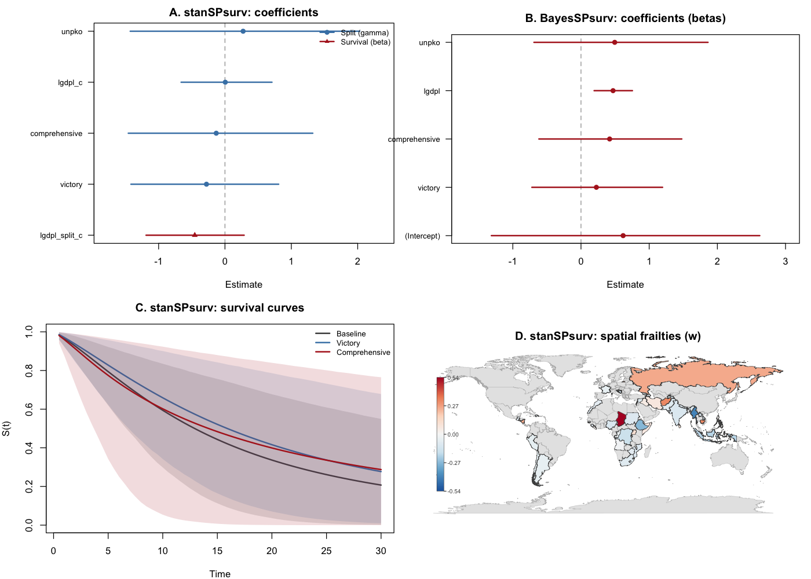
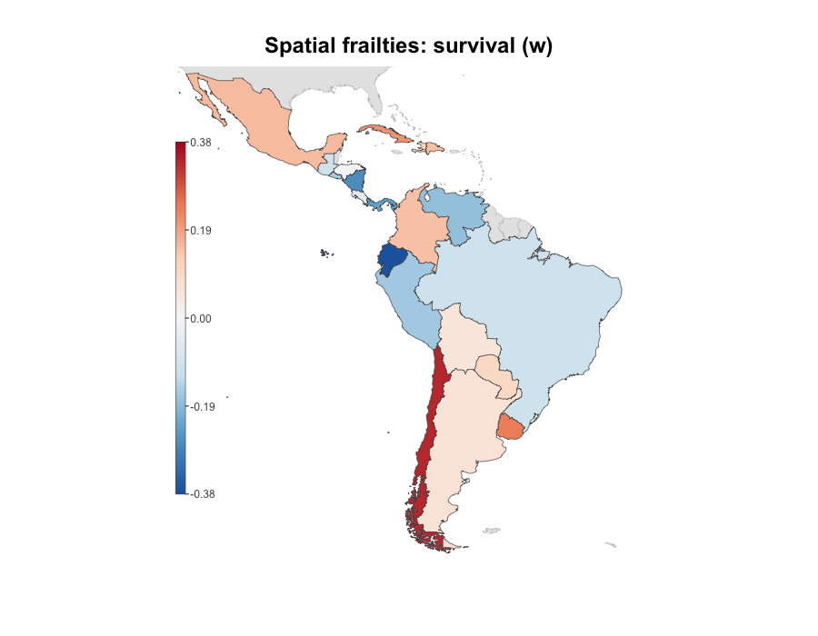

# stanSPsurv

<p align="center">
  
</p>

<!-- badges: start -->
[](https://github.com/Sergio-Bejar/stanSPsurv)
[](https://opensource.org/licenses/MIT)
[](https://lifecycle.r-lib.org/articles/stages.html#experimental)
<!-- badges: end -->

# What is `StanSPsurv`?

Standard survival models assume that every unit is at risk of
experiencing the event of interest. In many applications this assumption
does not hold: some units may be structurally immune to the event (e.g.,
post-conflict states that will never return to war, patients who are
cured of a disease). Split-population models address this by jointly
estimating two processes---a logistic model for the probability that a
unit is *susceptible* to the event, and a duration model for *how long*
susceptible units survive before the event occurs.

`stanSPsurv` fits Bayesian split-population (cure) survival models
using [Stan](https://mc-stan.org) via `cmdstanr`. It builds on [`BayesSPsurv`](https://github.com/Sergio-Bejar/BayesSPsurv)
(Bolte et al., 2021), but, by replacing the hand-coded MCMC sampler (slice
sampling and Metropolis-Hastings in C++) with Stan's Hamiltonian Monte
Carlo (HMC). This has two advantages. First, HMC explores
the posterior more efficiently than component-wise slice sampling,
delivering 40 to 1,000 times more effective samples per second on the
same data. Second, the Stan modeling language allows for seamlessly
extensions the model---adding new baseline hazards, alternative priors,
or hierarchical structures requires modifying a few lines of Stan code
rather than hundreds of lines of C++.


Users can estimate three model families---pooled, exchangeable-frailty,
and spatial CAR---with Weibull or log-logistic baselines, a simplified
interface built around `survival::Surv()`, and built-in functions for
coefficient plots, survival curves, susceptibility profiles, frailty
caterpillar plots, and choropleth maps.

## Installation

`stanSPsurv` requires [CmdStan](https://mc-stan.org/users/interfaces/cmdstan).
Install the toolchain first, then the package:

```r
# 1. Install cmdstanr (Stan's R interface)
install.packages("cmdstanr",
                 repos = c("https://stan-dev.r-universe.dev",
                           "https://cloud.r-project.org"))

# 2. Install CmdStan (C++ backend)
cmdstanr::install_cmdstan()

# 3. Install stanSPsurv
# install.packages("remotes")
remotes::install_github("Sergio-Bejar/stanSPsurv")
```

## Quick start

```r
library(stanSPsurv)

data(conflict_spells)

fit <- stan_pooled_spsurv(
  Surv(time, event) ~ victory + gdp + peacekeeping,
  split_formula = ~ gdp,
  data = conflict_spells,
  form = "weibull",
  chains = 4,
  parallel_chains = 4
)

summary(fit)
plot(fit)
```

## Model families

| Function | Structure | Frailties |
|---|---|---|
| `stan_pooled_spsurv()` | Pooled | None |
| `stan_exchange_spsurv()` | Exchangeable | iid normal per group |
| `stan_spatial_spsurv()` | Spatial CAR | BYM2 proper-CAR per area |

Each supports `form = "weibull"` or `form = "loglogistic"`.

Both `Surv(time, event)` and counting-process
`Surv(t0, time, event)` responses are supported. Counting-process models
require the `spell` argument and evaluate latent susceptibility once per
episode. Exchangeable and spatial models estimate separate frailties for
the split and survival stages; use
`frailty(fit, stage = "split")` or `frailty(fit, stage = "survival")`.

## Plotting

`stanSPsurv` includes five plotting functions, which use base R graphics.
The panel below shows, for instance, results on the Walter (2015) post-war peace data
(spatial Weibull model, 46 countries, 800 km adjacency graph):

<p align="center">
  
</p>

### Coefficient plot

```r
plot(fit)
```

### Survival curves

```r
plot_survival(fit, newdata = data.frame(victory = c(0, 1), gdp = 0,
                                        peacekeeping = 0),
              times = seq(0.5, 30, length.out = 60),
              labels = c("Baseline", "Victory"))
```

### Susceptibility and frailty

```r
plot_susceptibility(fit, variable = "gdp", data = conflict_spells)
plot_frailty(fit, stage = "survival")
```

### Choropleth map of spatial frailties

```r
plot_choropleth(fit, stage = "survival", regions = country_names)
```

<p align="center">
  
</p>

The `maps` back-end requires the `maps` package (in `Suggests`).
An `sf` back-end is also available for arbitrary spatial geometries:

```r
plot_choropleth(fit, stage = "survival", sf_map = my_sf, sf_key = "iso3")
```

## Validation

### Parameter recovery (simulation study)

100 replications of each of the six model specifications
(3 structures × 2 baselines) on data simulated with known parameters
(N = 500 per replication):

```sh
Rscript validation/simulation_study.R          # defaults: --reps 100 --N 500
Rscript validation/simulation_study.R --reps 5 # quick smoke test
```

| Structure | Baseline | Max abs. bias | Max RMSE | Coverage 90% | Divergences | Median sec |
|---|---|---|---|---|---|---|
| Pooled | Weibull | 0.014 | 0.110 | 87–93 % | 0 | 4.6 |
| Pooled | Log-logistic | 0.043 | 0.163 | 81–93 % | 0 | 2.8 |
| Exchangeable | Weibull | 0.025 | 0.135 | 86–90 % | 0 | 9.7 |
| Exchangeable | Log-logistic | 0.069 | 0.181 | 90–95 % | 0 | 5.8 |
| Spatial | Weibull | 0.031 | 0.133 | 85–97 % | 0 | 236 |
| Spatial | Log-logistic | 0.049 | 0.173 | 86–96 % | 0 | 242 |

### Comparison with BayesSPsurv

Head-to-head comparison on the same simulated data
(50 replications, N = 400, pooled and exchangeable Weibull, shape = 0.75):

| Metric                    | stanSPsurv  | BayesSPsurv |
|---------------------------|-------------|-------------|
| Bias (pooled)             | comparable  | comparable  |
| Bias (exchangeable gamma) | 0.09        | 0.21        |
| Coverage (exch. gamma)    | 96 %        | 84 %        |
| ESS / sec (pooled)        | 487–582     | 13          |
| ESS / sec (exchangeable)  | 304–468     | 0.3–3       |
| Wall time (pooled)        | 3 sec       | 152 sec     |
| Wall time (exchangeable)  | 6 sec       | 239 sec     |

It is important to note that two limitations of `BayesSPsurv` affect the comparison above. First, its Weibull
shape parameter is constrained to < 1 (only decreasing hazards). Further, a
case-sensitivity bug in its MCMC engine prevents the shape parameter from
being sampled unless patched locally.

### Walter (2015) benchmark

Pooled, exchangeable, and 800 km spatial runs completed with zero
divergences. See [`validation/walter`](validation/walter).

## Citation

```r
citation("stanSPsurv")
```

> Béjar S, Mukherjee B (2026). *stanSPsurv: Bayesian Split-Population
> Survival Models with Stan*. R package version 0.1.0.

## Authors

Sergio Béjar (first author and maintainer) and Bumba Mukherjee (coauthor).
